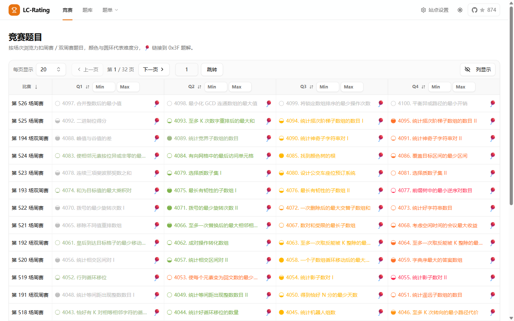
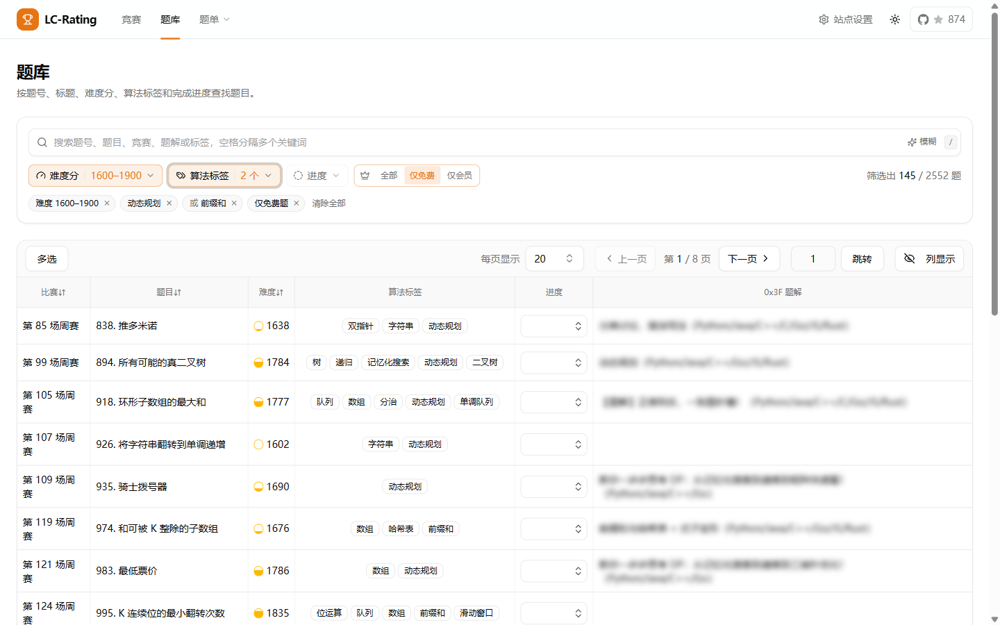
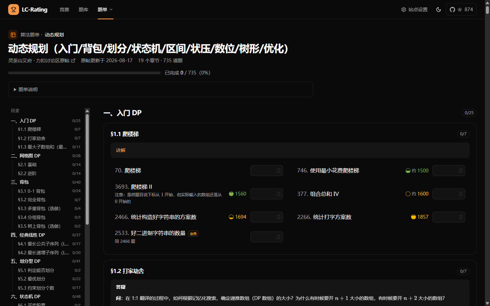

<div align="center">

# LC-Rating

**按难度分刷力扣：竞赛题分级 · 0x3F 算法题单 · 进度追踪**

[](https://huxulm.github.io/lc-rating/)
[](https://github.com/huxulm/lc-rating/releases)
[](https://github.com/huxulm/lc-rating/stargazers)
[](LICENSE)

[**🚀 立即使用**](https://huxulm.github.io/lc-rating/) · [竞赛题目](https://huxulm.github.io/lc-rating/contest/) · [题库](https://huxulm.github.io/lc-rating/problemset/) · [算法题单](https://huxulm.github.io/lc-rating/studyplan/sliding_window/) · [更新日志](https://github.com/huxulm/lc-rating/releases)



</div>

## 这是什么

LC-Rating 是一个面向算法学习者的力扣（LeetCode）刷题辅助站点。它把**周赛 / 双周赛题目**按真实竞赛数据得出的**难度分**整理出来，集成了**灵茶山艾府（0x3F）** 的全部算法题单，并帮你记录每道题的完成进度。

- **不知道刷哪道？** 按难度分挑题，从略高于自己水平的题开始，循序渐进
- **想系统学一个专题？** 跟着 0x3F 题单，按章节由浅入深
- **想知道自己学到哪了？** 每道题都能标记进度，题单每一节都有完成统计

所有数据都是静态文件，打开即用，无需注册；登录 GitHub 后可选择把进度同步到云端。

## 功能一览

### 🏆 竞赛题目

按场次浏览历届周赛与双周赛的 Q1–Q4，题目颜色和圆环直观展示难度分，🎈 直达 0x3F 题解。每一列都能按难度分区间筛选和排序。

### 🔎 题库



- **即时搜索**：题号、题目、竞赛、题解、标签都能搜，空格分隔多个关键词；题号精确匹配优先，按 <kbd>/</kbd> 快速聚焦
- **模糊搜索**：容忍错别字，按相似度排序
- **组合筛选**：难度分区间、算法标签（任一 / 全部匹配）、完成进度、会员题，结果数量和已选条件一目了然
- **批量标记**：多选题目一次性设置进度

### 📚 算法题单



完整收录 0x3F 的 12 个算法题单（共 3600+ 题），与原帖逐条一致，**每周自动同步**：

|                  |            |                    |              |
| ---------------- | ---------- | ------------------ | ------------ |
| 滑动窗口与双指针 | 二分算法   | 单调栈             | 网格图       |
| 位运算           | 图论算法   | 动态规划           | 常用数据结构 |
| 数学算法         | 贪心与思维 | 链表、二叉树与回溯 | 字符串       |

- 章节层级与原帖一致，吸顶目录显示每一节的完成进度并跟随滚动高亮
- 保留原帖的讲解、答疑、思考题与公式（KaTeX 渲染），以及每道题的备注、难度分和会员标记
- 不知道从哪开始？先读 0x3F 的 [如何科学刷题](https://leetcode.cn/discuss/post/3141566/ru-he-ke-xue-shua-ti-by-endlesscheng-q3yd/)

### ✅ 进度与偏好

- **进度追踪**：每道题可标记进度，进度选项（名称、颜色）可自定义
- **数据同步**：进度默认保存在浏览器本地；可复制站点数据备份、粘贴导入到其他设备，或登录 GitHub 同步到云端
- **偏好设置**：题目链接跳转力扣中国站或国际站、标签中英文切换、深色 / 浅色主题
- **移动端友好**：手机上同样可以浏览题单、筛选题库

## 关于难度分

难度分来自 [zerotrac/leetcode_problem_rating](https://github.com/zerotrac/leetcode_problem_rating)：根据周赛 / 双周赛选手的实际通过情况，基于 Elo 等级分与极大似然估计计算得出，用来衡量题目的相对难度。

| 难度分 | < 1200 | 1200–1400 | 1400–1600 | 1600–1900 | 1900–2100 | 2100–2400 | 2400–3000 | ≥ 3000 |
| ------ | ------ | --------- | --------- | --------- | --------- | --------- | --------- | ------ |
| 颜色   | ⚪ 灰  | 🟢 浅绿   | 🟢 绿     | 🟡 黄     | 🟠 橙     | 🟠 橙红   | 🔴 红     | 🟣 紫  |

非周赛题目通常没有难度分；题单中标注「约」的分数为 0x3F 给出的估计值。

**新手建议**：从 1000–1400 分的题目起步，做得比较顺之后再逐步提高；配合题单按专题练习，扎实掌握一个知识点再进阶。

## 本地开发

**环境要求**：Node.js ≥ 18、pnpm ≥ 10

```bash
pnpm install   # 安装依赖
pnpm dev       # 启动开发服务器 → http://localhost:3001/lc-rating/
pnpm build     # 构建静态站点
```

常用检查：

```bash
pnpm lint                 # ESLint
pnpm check-types          # 类型检查
pnpm --filter web test    # 单元测试（题单解析器、题库筛选）
```

<details>
<summary><b>项目结构</b></summary>

```
lc-rating/
├── apps/
│   ├── web/                     # 主站（Next.js App Router，静态导出）
│   │   ├── app/                 # 路由：contest / problemset / studyplan
│   │   ├── components/          # 按功能划分：Contest、ProblemSet、StudyPlan、common
│   │   ├── hooks/               # 进度、筛选、设置等状态（zustand + localStorage）
│   │   ├── scripts/studyplan/   # 题单数据生成脚本
│   │   └── public/
│   │       ├── problemset/      # 题目、竞赛、标签、题解数据
│   │       └── studyplan/       # 12 个题单的 JSON
│   └── v0/                      # 旧版站点
└── packages/                    # 共享的 ESLint / Tailwind / TypeScript 配置与 UI 组件
```

</details>

## 数据来源与更新

| 数据                 | 来源                                                                                                                    | 更新方式                           |
| -------------------- | ----------------------------------------------------------------------------------------------------------------------- | ---------------------------------- |
| 竞赛题目、题库、题解 | 力扣 + [0x3F 题解](https://leetcode.cn/u/endlesscheng/)                                                                 | GitHub Actions 每周一自动抓取      |
| 难度分               | [zerotrac/leetcode_problem_rating](https://github.com/zerotrac/leetcode_problem_rating)                                 | 随题库一起更新                     |
| 算法题单             | [灵茶山艾府在力扣讨论区的题单帖子](https://leetcode.cn/discuss/post/3141566/ru-he-ke-xue-shua-ti-by-endlesscheng-q3yd/) | `StudyPlan Updater` 每周一自动同步 |

题单脚本通过力扣 GraphQL 接口获取帖子的 Markdown 原文，确定性地解析出章节层级、题目、难度分与备注，生成 `apps/web/public/studyplan/<key>.json`：

```bash
cd apps/web
pnpm studyplan:update                # 更新全部题单
pnpm studyplan:update dynamic graph  # 只更新指定题单（按 key 前缀匹配）
pnpm studyplan:update --dry-run      # 只解析并打印统计，不写文件
```

- 题单列表（key ↔ 帖子 uuid）在 [`scripts/studyplan/plans.ts`](apps/web/scripts/studyplan/plans.ts)；新增题单时同时在 `config/constants.ts` 的 `STUDYPLANS` 和 `components/common/studyPlanMeta.ts` 中补充名称与图标
- 若解析出的题目数比现有数据骤减 30% 以上，脚本拒绝覆盖并以失败退出，提示原帖格式可能变化

## 参与贡献

欢迎提交 [Issue](https://github.com/huxulm/lc-rating/issues) 反馈问题或建议，也欢迎 PR：

1. Fork 并基于 `main` 新建分支
2. 提交前运行 `pnpm lint`、`pnpm check-types` 与 `pnpm --filter web test`
3. PR 中说明改动内容；涉及界面的改动请附截图

感谢所有贡献者：

<table>
  <tr>
    <td align="center"><a href="https://github.com/huxulm"><br /><sub><b>Huxulm</b></sub></a></td>
    <td align="center"><a href="https://github.com/Autumnal-Joy"><br /><sub><b>Autumnal-Joy</b></sub></a></td>
    <td align="center"><a href="https://github.com/Yorafa"><br /><sub><b>Tianle Wang</b></sub></a></td>
    <td align="center"><a href="https://github.com/wnykuang"><br /><sub><b>Wenyi Kuang</b></sub></a></td>
    <td align="center"><br /><sub><b>Kefei Qian</b></sub></td>
  </tr>
</table>

## 致谢

- [灵茶山艾府（0x3F）](https://space.bilibili.com/206214/)：算法题单与题解
- [zerotrac](https://github.com/zerotrac/leetcode_problem_rating)：题目难度分
- [lc-rating-backend](https://github.com/wnykuang/lc-rating-backend)：云端进度同步服务（Cloudflare Workers + D1）
- [力扣（LeetCode）](https://leetcode.cn/)：题目数据

## 许可证

[MIT](LICENSE) © Huxulm and contributors

<div align="center">

<a href="https://star-history.com/#huxulm/lc-rating&Date">
  <picture>
    <source media="(prefers-color-scheme: dark)" srcset="https://api.star-history.com/svg?repos=huxulm/lc-rating&type=Date&theme=dark" />
    
  </picture>
</a>

如果这个项目对你有帮助，欢迎点个 ⭐️

</div>
